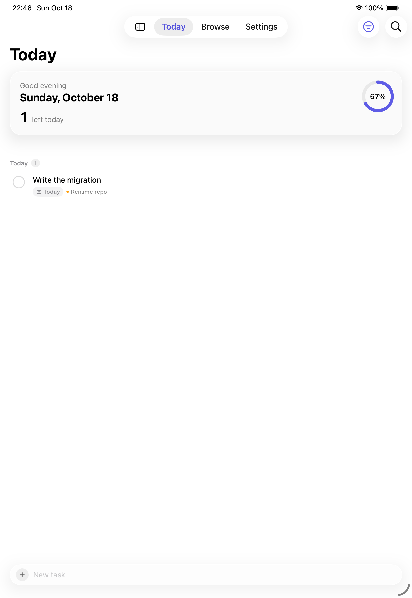
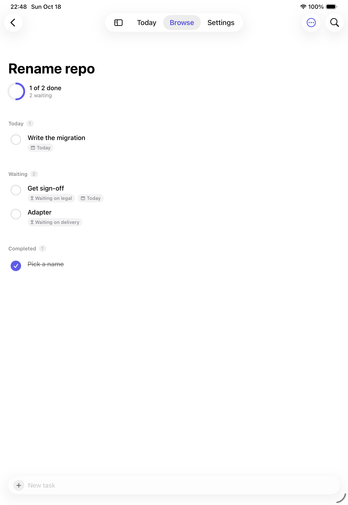
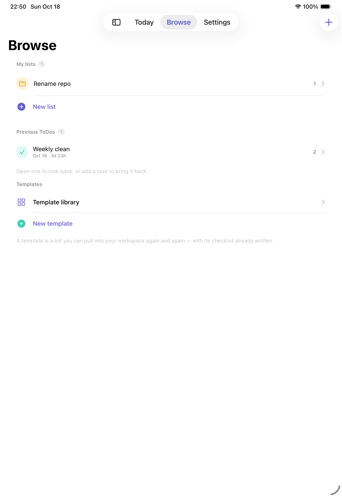
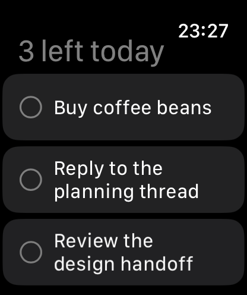

# Tos'n DOs

**Just another to-do list — except it gets out of the way.**

A quiet, fast to-do app for iPhone, iPad and Mac, with a watch app that shows what is left today.
Built with Swift, SwiftUI and SwiftData. No account, no ads, no subscription.

<p align="center">
  
  
  
  
</p>

---

## Why another to-do app

Open any app store and the to-do category looks the same: apps so loaded with features you cannot
find the one you need, apps that want a subscription and show ads, apps that ask you to create an
account before they will sync a single line of text.

Tos'n DOs started from a narrower question. While learning site reliability practice, every change
had to be walked through a checklist, step by step. That needed a list you can pull fresh each time —
same items, same order, nothing to retype. A to-do app with reusable templates turned out to be
exactly the thing worth building.

The rule for every feature since: it has to be obvious to someone who has never heard of any of this.

## What it does

**One screen for today.** The home screen shows what is due now and how much of it is done.
Everything else is one tap away.

**Type it the way you say it.** `Buy coffee beans tomorrow 3pm` becomes a task with a due date.
Dates are understood in Chinese and English — no forms, no pickers.

**Templates.** Write a checklist once, then pull a fresh copy whenever you need to run it again.

**Repeating lists.** A template can repeat daily, weekly or monthly. If the app was closed for three
weeks, it asks what to do about the ones you missed instead of silently dropping them.

**Waiting on someone else.** A task can be parked as *waiting for…* with a reason. Waiting tasks get
their own group and stay out of every number, because a thing you cannot act on should not make today
look heavier than it is.

**Look back.** Finished lists collect in Browse, and each one shows how long it took from first line
to last tick.

**The rest of it:** subtasks, tags, priority, deadlines with reminders, a home screen widget,
four languages (English, 简体中文, 繁體中文, 日本語), dark mode, Dynamic Type, and iCloud sync on
iPhone and iPad (the Mac keeps its data locally).

## Requirements

| | |
|---|---|
| Xcode | 26 or later |
| iPhone / iPad | iOS / iPadOS 18.0+ |
| Mac | macOS 15.0+ |
| Apple Watch | watchOS 10.0+ |

## Build and run

```bash
git clone https://github.com/<your-name>/tosn-dos.git
cd tosn-dos
open TosnDOs.xcodeproj
```

Pick the `TosnDOs` scheme and run. The simulator needs no signing.

For a signed build, set your own team and change the App Group identifier in
`Shared/SharedStore.swift` (`appGroupID`) plus the two `.entitlements` files — the default
`group.com.rikomiyazaki.TosnDOs` belongs to this project only. Without a group container the app
still runs: it falls back to a local store.

## How it is put together

```
Shared/          Models + the pieces both the app and the widget read
TosnDOs/         The iPhone / iPad / Mac app
TosnDOsWidget/   Home screen widget
TosnDOsWatch/    Apple Watch app
```

Three ideas carry most of the weight:

- **`TodayScope`** is the only definition of "today" in the codebase. The app, the widget and the
  watch all read it, so they can never disagree about what is due.
- **`SharedStore`** degrades instead of failing: CloudKit if the entitlement is there, a local file
  if it is not, memory if even that is unavailable.
- **`Localizable.xcstrings`** holds every string in four languages. Nothing is hard-coded in a view.

## Status

Working: everything above, on iOS, iPadOS, macOS and Apple Watch. The watch mirrors today's list
from the paired iPhone over WatchConnectivity, and a tick on the wrist flows back to the phone.

Not built yet: a share code — importing a list from a link or string. Share-as-text is in.

## 中文说明

一个安静、快速的待办清单，运行在 iPhone、iPad、Mac 上，手表端只显示「今天还剩什么」。
用 Swift + SwiftUI + SwiftData 写成，没有广告、不需要注册账号。

做的事：一屏看完今天 / 像说话一样输入就能识别日期 / 模板可反复拉取 / 模板支持按天周月重复，
漏掉的期数会问你要不要补 / 任务可以标记「等待中」且不计入任何数字 / 完成的清单会显示耗时 /
子任务、标签、优先级、截止提醒、小组件、四语言、深色模式。

iOS 18+、macOS 15+、watchOS 10+，Xcode 26。打开 `TosnDOs.xcodeproj` 直接运行即可，模拟器不需要签名。

## Credits

Course project for **XAUAT ISEI CST2601**, designed and directed by Riko Miyazaki.
Built in collaboration with the **WorkBuddy** agent (Tencent) running **DeepSeek-V4.1-Flash** —
the design decisions, the review and every judgement call along the way stayed with the author.

## License

MIT — see [LICENSE](LICENSE). Use it, change it, ship it; just keep the copyright notice.

Questions or ideas: [open an issue](https://github.com/<your-name>/tosn-dos/issues) or write to
rikomiyazaki@xauat.edu.cn.
