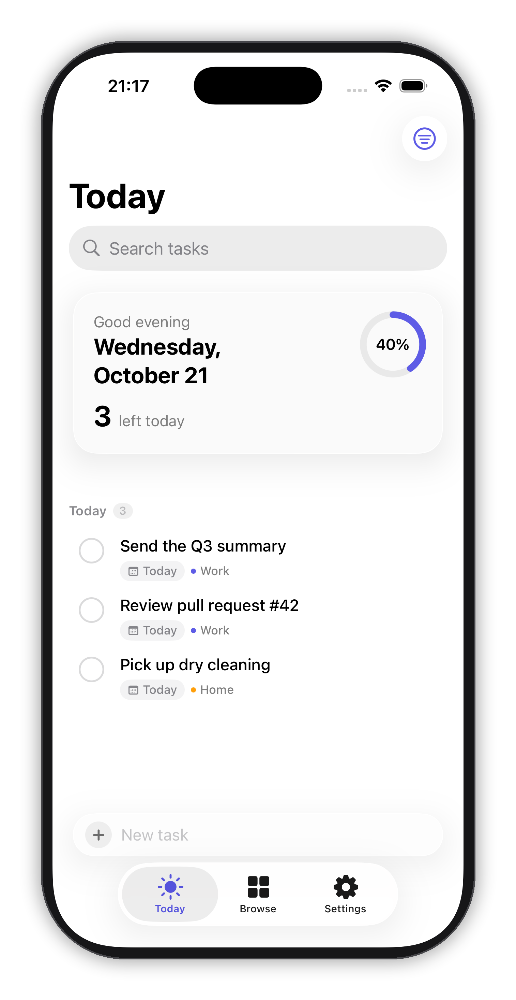
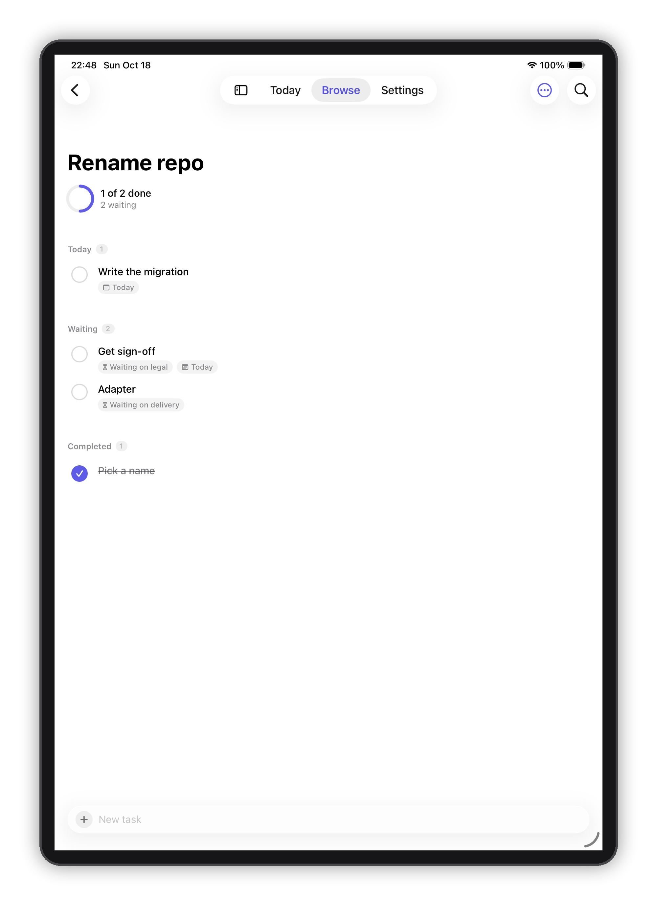
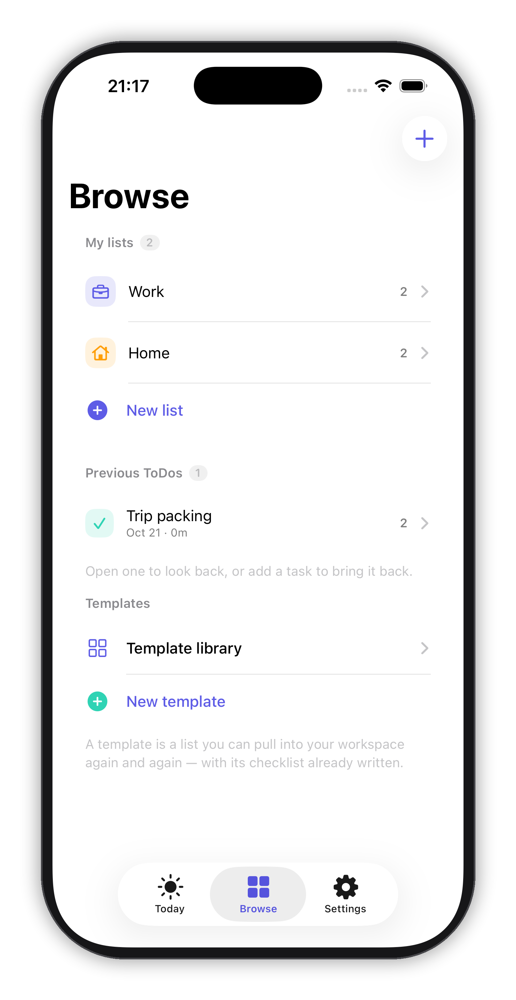
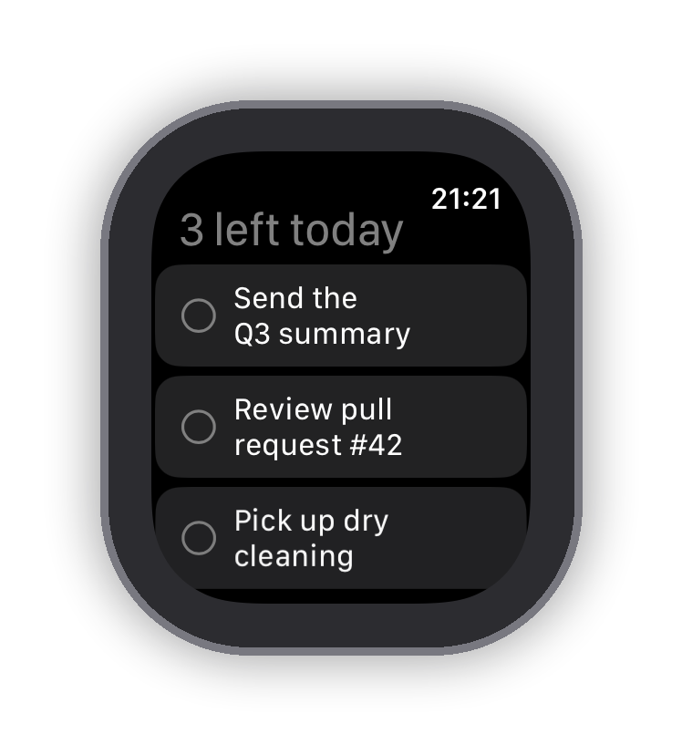

# Tos'n DOs

**Just another to-do list — except it gets out of the way.**

A quiet, fast to-do app for iPhone, iPad and Mac, with a watch app that shows what is left today.
Built with Swift, SwiftUI and SwiftData. No account, no ads, no subscription.

<p align="center">
  
  
  
  
</p>

---

## Requirements

| | |
|---|---|
| Xcode | 26 or later |
| iPhone / iPad | iOS / iPadOS 18.0+ |
| Mac | macOS 15.0+ |
| Apple Watch | watchOS 10.0+ |

## Build and run

```bash
git clone https://github.com/LycoRiko/tosn-dos.git
cd tosn-dos
open TosnDOs.xcodeproj
```

Pick the `TosnDOs` scheme and run. The simulator needs no signing.

For a signed build, set your own team and change the App Group identifier in
`Shared/SharedStore.swift` (`appGroupID`) plus the two `.entitlements` files — the default
`group.com.rikomiyazaki.TosnDOs` belongs to this project only. Without a group container the app
still runs: it falls back to a local store.

## How it is put together

```
Shared/          Models + the pieces both the app and the widget read
TosnDOs/         The iPhone / iPad / Mac app
TosnDOsWidget/   Home screen widget
TosnDOsWatch/    Apple Watch app
```

Three ideas carry most of the weight:

- **`TodayScope`** is the only definition of "today" in the codebase. The app, the widget and the
  watch all read it, so they can never disagree about what is due.
- **`SharedStore`** degrades instead of failing: CloudKit if the entitlement is there, a local file
  if it is not, memory if even that is unavailable.
- **`Localizable.xcstrings`** holds every string in four languages. Nothing is hard-coded in a view.

## Status

Working: everything above, on iOS, iPadOS, macOS and Apple Watch. The watch mirrors today's list
from the paired iPhone over WatchConnectivity, and a tick on the wrist flows back to the phone.

Not built yet: a share code — importing a list from a link or string. Share-as-text is in.

## 中文说明

一个安静、快速的待办清单，运行在 iPhone、iPad、Mac、Apple Watch上。
用 Swift + SwiftUI + SwiftData 写成，没有广告、不需要注册账号。

核心功能：像说话一样输入就能识别日期 / 模板可反复拉取和按天周月重复

iOS 18+、macOS 15+、watchOS 10+，Xcode 26。打开 `TosnDOs.xcodeproj` 直接运行即可，模拟器不需要签名。

## Credits

Designed and directed by Riko Miyazaki, built in collaboration with the **WorkBuddy** agent (Tencent) running **DeepSeek-V4.1-Flash**.

## License

MIT — see [LICENSE](LICENSE). Use it, change it, ship it; just keep the copyright notice.

Questions or ideas: [open an issue](https://github.com/LycoRiko/tosn-dos/issues)
